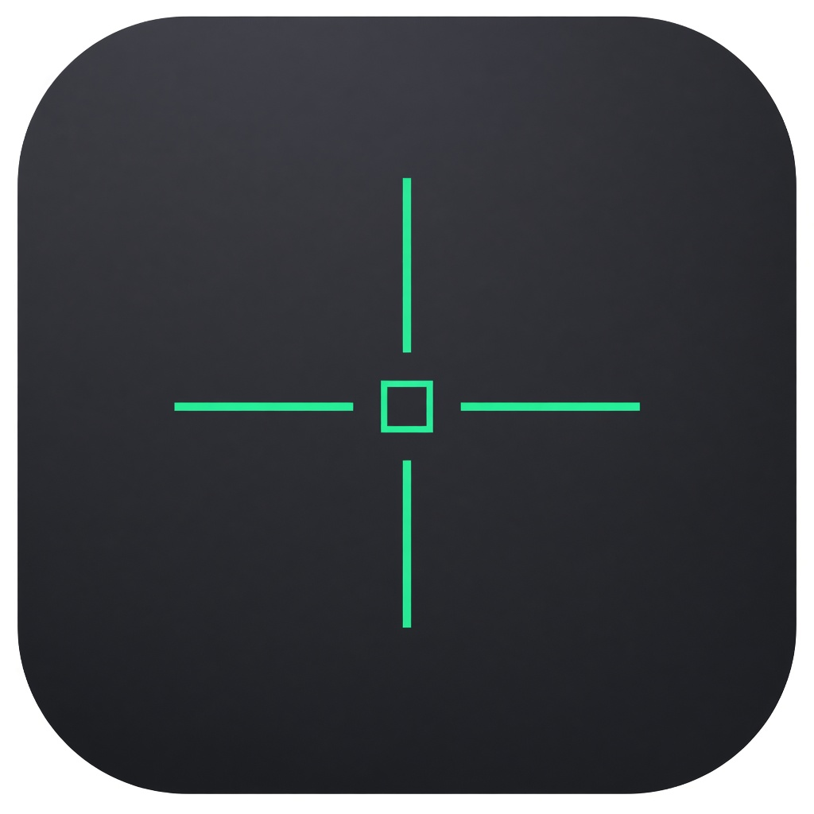

# Blink

<p align="center">
  
</p>

**Select any part of your screen. Get the text.**

Blink is a macOS menu-bar OCR tool. Press **⌘⇧2**, drag a region on any display, and the recognized plain text is copied to your clipboard. No Dock icon. Quiet by design.

> **Platform:** macOS **14+** (Sonoma). Uses ScreenCaptureKit + Vision. The deployment target is 14 so `SCScreenshotManager` and `SMAppService.mainApp` are available without shims.

## Features

| | |
| --- | --- |
| **⌘⇧2 capture** | Crosshairs overlay → drag-select → OCR → clipboard |
| **Menu bar** | Capture, Open at Login, Quit |
| **Open at Login** | `SMAppService` toggle |
| **Onboarding** | One brand screen, then Screen Recording prompt |

## Shortcuts

| Shortcut | Action |
| --- | --- |
| **⌘⇧2** | Start capture (crosshairs overlay) |
| **Esc** | Cancel capture — dismiss overlay, no OCR, no clipboard change |

While the overlay is up, the system pointer is hidden; mint crosshairs track the mouse 1:1 until you release a selection, press Esc, or the session ends.

## Build & run

```bash
open Blink.xcodeproj
```

Or from the CLI:

```bash
xcodebuild -scheme Blink -configuration Debug -destination 'platform=macOS' build
xcodebuild -scheme Blink -configuration Debug -destination 'platform=macOS' test
```

Run the app from Xcode (⌘R). Grant **Screen Recording** when prompted (required for capture).

Unsigned local builds: System Settings → Privacy & Security may ask you to allow Blink after the first launch.

## Permissions

| Permission | Why |
| --- | --- |
| **Screen Recording** | Capture the framed region |

If Screen Recording is off, the menu shows an actionable banner that opens System Settings.

## Tests & CI

- Unit tests cover hotkey parsing, OCR text normalization, and selection geometry (`BlinkTests`).
- GitHub Actions (`.github/workflows/ci.yml`) builds and runs tests on `macos-latest` for every push/PR.
- Overlay + global hotkey + clipboard cannot be fully driven in CI — see [MANUAL_SMOKE.md](MANUAL_SMOKE.md).

## License

MIT — see [LICENSE](LICENSE).
